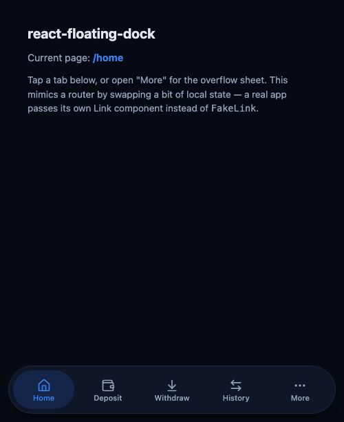

# react-floating-dock

A floating, fully-rounded bottom navigation bar for React, in the style of WhatsApp's mobile tab
bar: an animated pill slides behind the active tab, and an optional "More" button opens the rest
of your destinations in a bottom sheet.

Framework-agnostic — it doesn't assume Next.js, React Router, or Tailwind. Bring your own router's
`Link` component and your own colors.



## Install

```bash
npm install react-floating-dock framer-motion
```

`react`, `react-dom` and `framer-motion` are peer dependencies — install them if your project
doesn't already have them.

## Quick start

```tsx
import { FloatingDock, type DockItem } from "react-floating-dock";
import "react-floating-dock/style.css";
import { Home, Wallet, ArrowLeftRight, User, Settings } from "lucide-react";
import Link from "next/link"; // or your router's Link
import { usePathname } from "next/navigation";

const items: DockItem[] = [
  { key: "home", href: "/", label: "Home", icon: Home },
  { key: "wallet", href: "/wallet", label: "Wallet", icon: Wallet },
  { key: "activity", href: "/activity", label: "Activity", icon: ArrowLeftRight },
];

const moreItems: DockItem[] = [
  { key: "profile", href: "/profile", label: "Profile", icon: User },
  { key: "settings", href: "/settings", label: "Settings", icon: Settings },
];

export function AppNav() {
  const pathname = usePathname();

  return (
    <FloatingDock
      items={items}
      moreItems={moreItems}
      isActive={(href) => pathname === href}
      LinkComponent={Link}
    />
  );
}
```

That's it — four or five primary tabs, an overflow sheet for the rest, and a theme you can
override with CSS custom properties.

See [`example/`](./example) for a complete, runnable demo (`pnpm example`).

## Why a `LinkComponent` prop instead of just using `<a>`?

So client-side navigation works with whatever router you're on. Most router `Link` components
accept `href`, `className` and `children` — the same shape this package expects — so passing
`next/link`'s `Link`, React Router's `Link`, or TanStack Router's `Link` directly just works. If
you don't pass one, it falls back to a plain `<a href>`.

## API

### `<FloatingDock />`

| Prop             | Type                                  | Default        | Description                                                                 |
| ----------------- | -------------------------------------- | -------------- | ----------------------------------------------------------------------------- |
| `items`           | `DockItem[]`                           | —              | Destinations shown directly in the bar. Four or five is the sweet spot.       |
| `moreItems`       | `DockItem[]`                           | `[]`           | Extra destinations shown in the overflow sheet. Omit to hide the "More" button entirely. |
| `isActive`        | `(href: string) => boolean`            | —              | Tells the dock which item (if any) is the current page.                       |
| `LinkComponent`   | `ComponentType<DockLinkProps>`         | plain `<a>`    | Your router's Link component.                                                 |
| `moreLabel`       | `string`                               | `"More"`       | Label under the overflow button.                                              |
| `moreSheetTitle`  | `string`                               | `"Menu"`       | Heading inside the overflow sheet.                                            |
| `closeLabel`      | `string`                               | `"Close"`      | `aria-label` for the sheet's close button.                                    |
| `extraContent`    | `ReactNode`                            | —              | Rendered below the overflow grid — a natural slot for a theme toggle, sign-out button, language switcher, etc. |
| `ariaLabel`       | `string`                               | `"Main"`       | `aria-label` on the `<nav>` element.                                          |
| `className`       | `string`                               | —              | Extra class on the `<nav>`, alongside the built-in one.                       |

```ts
interface DockItem {
  key: string;       // React key, usually the same as href
  href: string;
  label: string;
  icon: ComponentType<{ className?: string }>; // any icon component — lucide-react, heroicons, your own SVGs
}
```

### `<DockDrawer />`

The bottom sheet `FloatingDock` uses internally for its overflow menu. Exported separately because
it's useful on its own for any mobile-style sheet (filters, a confirmation prompt, etc.).

| Prop         | Type         | Default   | Description                        |
| ------------ | ------------ | --------- | ----------------------------------- |
| `open`       | `boolean`    | —         | Whether the sheet is visible.       |
| `onClose`    | `() => void` | —         | Called on backdrop click, Escape, or the close button. |
| `title`      | `string`     | —         | Heading shown in the sheet's header. |
| `children`   | `ReactNode`  | —         | Sheet body.                          |
| `closeLabel` | `string`     | `"Close"` | `aria-label` for the close button.   |

## Styling

Import `react-floating-dock/style.css` once, anywhere in your app. It's plain CSS driven entirely
by custom properties, so no Tailwind (or any other build-time CSS tooling) is required.

To theme it, redefine the variables wherever makes sense for your app — `:root` for a global
theme, or a wrapper element for something scoped:

```css
:root {
  --rfd-bg: rgba(255, 255, 255, 0.9);        /* bar + sheet background */
  --rfd-bg-solid: #ffffff;                    /* sheet background (no backdrop-filter) */
  --rfd-border: #e2e8f0;
  --rfd-text: #0f172a;
  --rfd-text-muted: #64748b;
  --rfd-accent: #3b82f6;                      /* active tab color */
  --rfd-accent-bg: rgba(59, 130, 246, 0.12);   /* active tab's pill background */
  --rfd-accent-contrast: #ffffff;              /* text/icon color on top of --rfd-accent */
  --rfd-hover: rgba(0, 0, 0, 0.05);
  --rfd-shadow: 0 20px 25px -5px rgba(0, 0, 0, 0.15);
  --rfd-radius: 9999px;                        /* fully rounded by default — set a smaller value for softer corners */
}
```

All of the dock's classes are prefixed `rfd-` to avoid collisions with the rest of your app's CSS.

## Accessibility

- The active tab gets `aria-current="page"`.
- The overflow sheet is a `role="dialog"` with `aria-modal="true"`, traps body scroll while open,
  and closes on Escape.
- Every interactive element is a real `<button>` or your `LinkComponent`, so it's reachable and
  operable by keyboard out of the box.

## Development

```bash
pnpm install
pnpm test        # vitest
pnpm typecheck
pnpm lint
pnpm build        # outputs dist/ (ESM + CJS + types + style.css)
pnpm example      # runs the example app against the live source, at localhost:5173
```

## License

MIT
